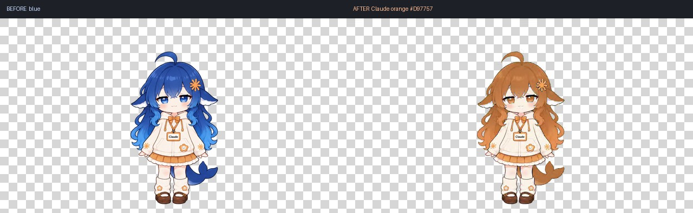

# Claude 大肥鱼·橙（社区角色包）

*觉得肥鱼cos的克劳德不够彻底？那就让肥鱼重新染发带美瞳！*
---
111 段站立形态透明动画。基于同仓库的蓝色角色包 [`community-pets/claude-dafeiyu`](../claude-dafeiyu/) 做**颜色重映射**：

- 蓝色/青色相（约 150°–275°）→ Claude 橙 `#D97757`；
- 线条、轮廓、造型、透明度通道不变，不是重画；
- 输出 640×360 VP9-alpha，24fps。



## 安装

需要 dsh-pet **0.4.9+**（或本分支引擎）已经创建过 `%USERPROFILE%\.dsh\dsh-pet\pet` 目录。

```powershell
powershell -NoProfile -ExecutionPolicy Bypass -File .\install.ps1
```

安装器会把下面两项复制到 pet 目录：

```
%USERPROFILE%\.dsh\dsh-pet\pet\claude-dafeiyu-orange-config.json
%USERPROFILE%\.dsh\dsh-pet\pet\claude-dafeiyu-orange-animation\
```

使用独立 id `claude-dafeiyu-orange`，**可以和蓝色 `claude-dafeiyu` / 托腮包共存**。

装完后刷新网页，或右键宠物 →「重载配置」；两只都隐藏时重启 DSH。

默认 `display: both`。想只在网页或只在桌面显示，到 dsh-pet 设置页的「桌宠配置」里改。

## 卸载

```powershell
powershell -NoProfile -ExecutionPolicy Bypass -File .\uninstall.ps1
```

或直接删除上面两个路径。

## 兼容性

- **官方 dsh-pet 0.4.9**：111 段动作、点击回应、工作状态联动正常；分支专属的换装、随机动作链、办公入场/收尾不会生效。
- **本分支引擎**：作为独立橙色角色包加载，配置里的 `outfit` 标记为「Claude-大肥鱼-橙（站立）」。

## 验证

- 111/111 段时长与源包一致（误差 < 0.7s）；
- 角像素 alpha = 0，透明通道正常；
- 抽样帧蓝色像素占比 < 0.3%；
- 从 dsh-pet 的 `/thumb/claude-dafeiyu-orange/...` 取回的文件与包内文件 SHA-256 一致。

## 来源与许可

- 角色与原始蓝色动画：[`community-pets/claude-dafeiyu`](../claude-dafeiyu/)。
- 颜色派生版与仓库使用同一许可；保留上游作者署名，不单独声明新的版权。
- 这是社区角色包，不修改引擎代码；如只需要蓝色原版，继续使用 `community-pets/claude-dafeiyu`。
